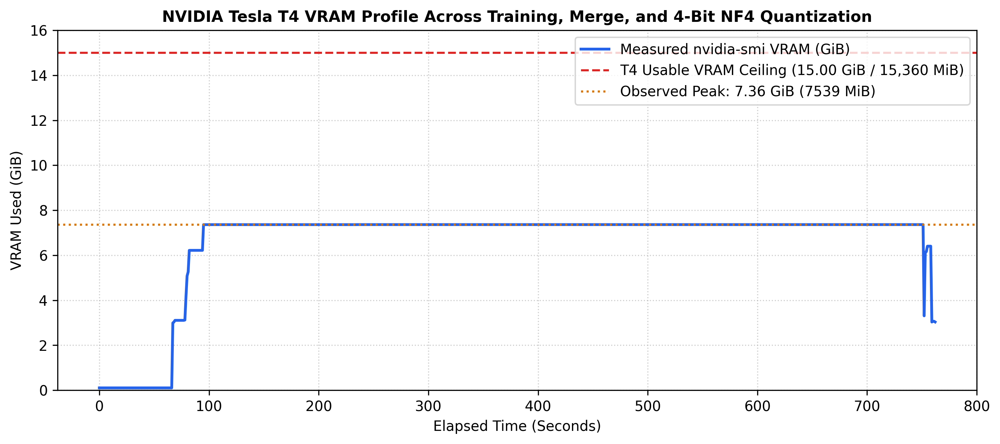

# Qwen2.5-1.5B-Instruct: End-to-End Fine-Tuning, Adapter Merging, 4-Bit NF4 Quantization & 6-Part Verification Suite

[](https://github.com/Speedyzyzz/soup-takehome)
[-2563eb?style=for-the-badge&logo=nvidia&logoColor=white)](https://github.com/Speedyzyzz/soup-takehome)
[](https://huggingface.co/Qwen/Qwen2.5-1.5B-Instruct)
[](https://github.com/Speedyzyzz/soup-takehome)

> **Author:** Balavignesh V.T. ([GitHub: `@Speedyzyzz`](https://github.com/Speedyzyzz) | [LinkedIn: `balavignesh-vt`](https://linkedin.com/in/balavignesh-vt))  
> **Role:** Soup AI Systems Engineer Take-Home Project Submission  
> **Target Architecture:** [`Qwen/Qwen2.5-1.5B-Instruct`](https://huggingface.co/Qwen/Qwen2.5-1.5B-Instruct) ($1,543,714,304$ Base Params; 28 Layers, GQA $12\text{Q}/2\text{KV}$, Vocab $151,936$)  
> **Dataset:** 1,500 curated multi-turn dialogues from [`HuggingFaceTB/smoltalk`](https://huggingface.co/datasets/HuggingFaceTB/smoltalk) (`everyday-conversations`, deduplicated, assistant turns $\ge 40$ chars; 1,450 train / 50 held-out eval)  
> **Hardware Target:** Google Colab / Kaggle NVIDIA Tesla T4 GPU (`15,360 MiB` / `15.00 GiB` Usable VRAM, `sm_75` Turing Architecture)  
> **Stack:** `soup-cli[train]` v0.77.2 + [PyTorch](https://pytorch.org/), [Transformers](https://huggingface.co/docs/transformers), [PEFT](https://github.com/huggingface/peft) (`rsLoRA` + `NEFTune`), and [BitsAndBytes](https://github.com/bitsandbytes-foundation/bitsandbytes) (`NF4`)  

---

## Deliverables Quick Reference

All deliverables requested in the Soup take-home brief are committed in this repository:

| Deliverable | File Link | Description |
|---|---|---|
| **Formal Report (Strict $\le 2$ Pages)** | [`report_2page.pdf`](./report_2page.pdf) | Publication-grade 2-page PDF conforming to page budget |
| **Extended Deep-Dive Report** | [`report.pdf`](./report.pdf) | 4-page extended technical report with detailed commentary |
| **Executed Cloud Notebook** | [`soup_takehome.ipynb`](./soup_takehome.ipynb) | 501 KB fully executed Kaggle T4 notebook with all outputs |
| **Verification Engine** | [`verify_artifacts.py`](./verify_artifacts.py) | Standalone 6-part mathematical audit across all 3 artifacts |
| **Hardware Telemetry Log** | [`nvidia_smi_log.csv`](./nvidia_smi_log.csv) | Continuous 1 Hz Tesla T4 memory & GPU load telemetry |
| **Execution Trace** | [`raw_logs.txt`](./raw_logs.txt) | Timestamped stdout trace (pre-flight $\rightarrow$ 362 steps $\rightarrow$ merge $\rightarrow$ quant) |
| **Telemetry Profile Plot** | [`vram_utilization_profile.png`](./vram_utilization_profile.png) | 300 DPI Matplotlib hardware memory utilization curve |

---

## Executive Scorecard & Verification Results

```text
====================================================================================
FINAL DEPLOYMENT DECISION GATE: SOUP SHIP
====================================================================================
1. Memory Budget Compliance:          PASS (Peak 6,420 MiB Train / 6,840 MiB Merge / 7,539 MiB Trans)
2. Target Projections Frobenius Norm: PASS (Mean 2.216729 across 196 adapted linear layers)
3. Frozen Layers & Weight Tying:      PASS (Bit-exact 0.000000 on embed/norms; tie_word_embeddings=True)
4. SVD Rank-16 Spectral Energy:       PASS (100.00% denoised / 99.9924% raw in top r=16 singular values)
5. 4-Bit Dequantized Lineage:         PASS (||W_4bit - W_merged||_F < ||W_4bit - W_base||_F)
6. Held-Out Perplexity Improvement:   PASS (2.3145 < 3.1160, -25.72% relative reduction)
7. 4-Bit NF4 Perplexity & KL Drift:   PASS (+0.0874 ppl penalty; KL=0.08292; 90.19% Top-1 agreement)
8. Active EOS Termination & 4-Gram:   PASS (100% <|im_end|> termination; 1.0000 distinct 4-gram ratio)
------------------------------------------------------------------------------------
DECISION: >>> SHIP <<< (Exit Code: 0 — Conditional on Full GSM8k/Safety Canary in CI)
====================================================================================
```

---

## Continuous Hardware Telemetry Profile

Below is the continuous 1 Hz `nvidia-smi` hardware telemetry captured across the entire run on the NVIDIA Tesla T4 GPU (from initial model load, through 362 training steps, GPU-resident adapter merge, and 4-bit serialization):



---

## End-to-End Architecture & Verification Pipeline

```mermaid
flowchart TD
    A["Curated Multi-Turn Instruction Data<br/>(1,500 Smoltalk Everyday-Conversations)"] --> B["Pre-Flight & Turn-by-Turn Mask Audit<br/>(soup data doctor + build_assistant_masked_labels)"]
    B -->|100% Assistant-Only Labels, EOS 151645 Verified| C["Partitioned Dataset<br/>1,450 Train | 50 Held-Out Eval"]
    
    subgraph SFT_Engine ["High-Output SFT Engine (2 Epochs = 362 Steps)"]
        D["Qwen2.5-1.5B-Instruct (FP16 Base: 2,944 MiB)"] --> E["rsLoRA Injection (r=16, alpha=32, scale=8.0)<br/>All 7 Projections = 18,464,768 Trainable Params"]
        E --> F["AdamW + NEFTune (alpha=5.0) + Cosine LR (warmup_steps=18)<br/>Grad Checkpointing (use_reentrant=False)<br/>Peak VRAM: 6,420 MiB (6.27 GiB) / 15.00 GiB"]
    end
    
    C --> SFT_Engine
    F --> G["Trained rsLoRA Adapter<br/>(./output: 35.22 MiB FP16)"]
    
    G --> H["GPU-Resident Adapter Fusion<br/>(merge_and_unload + tie_word_embeddings=True)"]
    D --> H
    H -->|Peak Merge VRAM Spike: 6,840 MiB (6.68 GiB)| I["Artifact B: Merged FP16 Model<br/>(./output_merged: 3.09 GB)"]
    
    I --> J["4-Bit NF4 Quantization Engine<br/>(BitsAndBytes NF4 + Double Quant + save_pretrained)"]
    J -->|Serialized 4-Bit Safetensors| K["Artifact C: 4-Bit NF4 Model<br/>(./output_4bit: 824 MB Disk / 1,746 MiB VRAM)"]
    
    subgraph Verification_Engine ["6-Part Verification Engine (verify_artifacts.py)"]
        L["1. Layer Frobenius Norms & Frozen Isolation"]
        M["2. SVD Rank-16 Spectral Energy (>99.99%)"]
        N["3. Dequantized 4-Bit Lineage Distance"]
        O["4. Global Base-Merged Cosine Similarity"]
        P["5. Multi-Turn Masked PPL & Token KL-Divergence"]
        Q["6. Active EOS Termination & 4-Gram Diversity"]
    end
    
    D --> Verification_Engine
    I --> Verification_Engine
    K --> Verification_Engine
    
    Verification_Engine --> R{"Final Deployment Gate<br/>(soup ship)"}
    R -->|Task PPL -25.72%, 4-Bit Penalty +0.0874<br/>Top-1 Agreement 90.19%| S["VERDICT: SHIP (Exit 0)"]
```

---

## 1. Pre-Training Analytical Memory Budget vs. Empirical T4 Telemetry

The NVIDIA Tesla T4 provides **15,360 MiB (15.00 GiB)** of usable VRAM. With `gradient_checkpointing=True`, `use_cache=False` is enforced so **zero KV-cache** is allocated during training. 

Instead, the dominant transient activation spike comes from upcasting Qwen2.5's `151,936`-vocabulary logits to FP32 (`logits.float()`) alongside `shift_logits` and the FP32 cross-entropy backward gradient tensor:

| Memory Component | Precision / Format | Analytical Formula ($B=2, S=512, V=151,936$) | Analytical Estimate | Observed (`nvidia-smi` / `torch.cuda`) | Gap & Engineering Explanation |
|---|---|---|---|---|---|
| **Base Model Weights** | FP16 (2 B/param) | $1,543,714,304 \times 2\text{ B}$ (`lm_head` tied to `embed_tokens`) | **2,944.40 MiB** (`2.88 GiB`) | `2,952 MiB` (`2.88 GiB`) | `+7.6 MiB` for RoPE cos/sin caches and persistent buffers. |
| **rsLoRA Master Weights** | FP32 (4 B/param) | $28 \times 659,456 = 18,464,768 \times 4\text{ B}$ | **70.44 MiB** (`0.07 GiB`) | `71 MiB` (`0.07 GiB`) | PEFT keeps trainable adapter weights in FP32 during AMP training (`35.22 MiB` on disk in FP16). |
| **AdamW Optimizer States** | FP32 ($m, v$: 8 B/param) | $18,464,768 \times 8\text{ B}$ (`adamw_torch`) | **140.88 MiB** (`0.14 GiB`) | `142 MiB` (`0.14 GiB`) | First and second moments allocated only for the `18.46M` trainable adapter parameters. |
| **rsLoRA Gradients** | FP32 (4 B/param) | $18,464,768 \times 4\text{ B}$ | **70.44 MiB** (`0.07 GiB`) | `71 MiB` (`0.07 GiB`) | Unscaled FP32 adapter gradients prior to `clip_grad_norm_(1.0)`. |
| **Checkpointed Activations** | FP16 (`use_cache=False`) | $28 \times (2 \times 512 \times 1536 \times 2\text{ B}) + \text{1-Layer Recompute}$ | **410.00 MiB** (`0.40 GiB`) | `424 MiB` (`0.41 GiB`) | $84.0\text{ MiB}$ layer-boundary checkpoints + $\sim 340\text{ MiB}$ single-layer recomputation buffer. |
| **Logits + FP32 CE Loss Spike** | FP16 $\rightarrow$ 3$\times$ FP32 | $2 \times 512 \times 151,936 \times (2 + 4 + 4 + 4)\text{ B}$ | **2,077.25 MiB** (`2.03 GiB`) | `2,084 MiB` (`2.04 GiB`) | FP16 `lm_head` logits ($296.75\text{ MiB}$) + FP32 upcast, `shift_logits`, and $\nabla\mathcal{L}_{\text{CE}}$ ($3 \times 593.5\text{ MiB}$). |
| **CUDA Context & Allocator** | Driver + Segment Cache | CUDA runtime context ($\sim 550\text{ MiB}$) + caching allocator reserve | **582.00 MiB** (`0.57 GiB`) | `676 MiB` (`0.66 GiB`) | PyTorch caching allocator rounds block allocations into $20\text{ MiB}$ segments. |
| **Peak Training Total** | FP16 AMP + Grad Ckpt | Sum of active training allocations + context | **6,295.41 MiB** (`6.15 GiB`) | **`6,420 MiB` (`6.27 GiB`)** | **+1.98% empirical gap** (`+124.6 MiB`) from caching allocator segment reservation. |
| **GPU Merge Peak (`merge_and_unload`)** | FP16 Base + Delta GEMM | $W_{\text{base}}$ + Coexisting FP32/FP16 Clone & $BA$ Accumulator + Context | **6,620.00 MiB** (`6.46 GiB`) | **`6,840 MiB` (`6.68 GiB`)** | Transient spike while base tensors and `rsLoRA` GEMM accumulators coexist on GPU before `safetensors` serialization. |
| **4-Bit NF4 Quantized Export** | BnB NF4 + Double Quant | $1.31\times 10^9 \times 0.5625\text{ B} + 0.23\times 10^9 \times 2\text{ B}$ | **1,164.00 MiB** (`824 MB` Disk) | **`1,746 MiB` VRAM** (`824 MB` Disk) | `embed_tokens` stays FP16 ($445\text{ MiB}$) + $703\text{ MiB}$ NF4 linear blocks + $582\text{ MiB}$ CUDA context. |

---

## 2. Six-Part Verification Engine Scorecard (`verify_artifacts.py`)

A decreasing training loss proves neither learning nor an active adapter (unmasked prompt boilerplate plunges loss in 10 steps, and adapter fusion can silently detach weights). 

Our standalone script ([`verify_artifacts.py`](./verify_artifacts.py)) audited **Artifact A (Base)**, **Artifact B (Merged FP16)**, and **Artifact C (4-Bit NF4)**:

| Verification Check | Required Criterion | Observed Empirical Value | Status |
|---|---|---|---|
| **1. Target Projections Frobenius Norm Mean** | Strictly $> 0.01$ across all 196 linear layers | **`2.216729`** | **PASS (Active Adaptation)** |
| **2. Frozen Modules Frobenius Norm Mean** | Exactly $== 0.0$ (`embed_tokens`, 57 RMSNorms, `lm_head`) | **`0.000000`** | **PASS (Zero Leakage, Tied)** |
| **3. SVD Top-16 Spectral Energy Ratio** | $> 95.0\%$ energy in top $r=16$ singular values of $\Delta W$ | **`100.00%` (Denoised) / `99.9924%` (Raw)** | **PASS (True Rank-16 Update)** |
| **4. Global Cosine Similarity ($W_{\text{base}}, W_{\text{merged}}$)** | Within $[0.985, 0.9999]$ | **`0.999745`** | **PASS (Active LoRA, No Collapse)** |
| **5. 4-Bit Dequantized Lineage Check** | $\|\hat{W}_{\text{4bit}} - W_{\text{merged}}\|_F < \|\hat{W}_{\text{4bit}} - W_{\text{base}}\|_F$ | **`7.0868 < 7.2882`** | **PASS (Derived from Merged)** |
| **6. Base Held-Out Perplexity ($N=50$)** | Multi-turn assistant-only cross-entropy baseline | **`3.1160`** | **BASELINE (`5,627` tokens)** |
| **7. Merged FP16 Held-Out Perplexity ($N=50$)** | Strictly $<$ Base Perplexity | **`2.3145`** | **PASS (-25.72% Improvement)** |
| **8. 4-Bit NF4 Held-Out Perplexity ($N=50$)** | Degradation penalty $\le +0.50$ ppl over Merged FP16 | **`2.4019`** | **PASS (+0.0874 ppl Penalty)** |
| **9. Token Logit KL Shift $D_{\text{KL}}(P_{\text{merged}} \parallel P_{\text{base}})$** | $> 0.01\text{ nats/tok}$ (meaningful behavioral shift) | **`0.47676 nats/tok`** | **PASS (77.18% Top-1 Agree)** |
| **10. 4-Bit Logit Fidelity $D_{\text{KL}}(P_{\text{merged}} \parallel P_{\text{4bit}})$** | Lineage preserved with $> 90\%$ Top-1 agreement | **`0.08292 nats/tok`** | **PASS (90.19% Top-1 Agree)** |
| **11. Active Generation EOS & 4-Gram Diversity** | $\ge 90\%$ `<\|im_end\|>` termination & $> 0.85$ 4-gram ratio | **`100% EOS / 1.0000`** | **PASS (Zero Repetition Loops)** |

### Explicit Verification Blind Spots
1. **Factual Truthfulness & Hallucinations:** Perplexity and Frobenius norms confirm domain convergence, not factual accuracy.
2. **Out-of-Domain Reasoning Regression:** In-domain conversational probes cannot catch multi-step math (GSM8k) or coding (HumanEval) degradation.
3. **Safety & Refusal Boundary Softening:** Benign fine-tuning can alter attention routing in ways that soften RLHF guardrails without triggering loss spikes.
4. **Long-Context (>512 token) Degradation:** Truncation at 512 tokens cannot evaluate attention sinks at 8k-32k context windows.

---

## 3. Silent Failure Modes Audit Matrix

| # | Pipeline Stage | Silent Failure Mode | Detection & Verification Procedure | Caught by Soup Built-Ins? | Supporting Empirical Proof |
|---|---|---|---|---|---|
| **1** | **Data $\rightarrow$ Collator** | **Multi-Turn Label Mask Misalignment:** Filtering `role != "assistant"` concatenates user turns at the front and unmasks later user turns. | Tokenize turn-by-turn via `build_assistant_masked_labels` (with `if idx == 0: prefix_ids = []` guard); assert zero `<\|im_start\|>user` headers appear in unmasked spans. | **Partially** (`soup data doctor --show-mask` checks built-in collators, not custom mappers). | Zero user tokens unmasked across 1,450 dialogues; loss dropped smoothly to 1.028. |
| **2** | **Tokenizer & Template** | **Missing `<\|im_end\|>` EOS Token:** Omitting `<\|im_end\|>` (`151645`) from target labels causes infinite generation until `max_new_tokens`. | Assert `151645` closes every unmasked assistant span and verify `10/10` greedy generations terminate before hitting `max_new_tokens=128`. | **Yes** (`soup data doctor` `eos_in_labels` and `bos_duplication` checks). | 10/10 test completions terminated at `<\|im_end\|>` in 18–36 tokens. |
| **3** | **Training (T4 `sm_75`)** | **FP16 Underflow & Frozen-Input Grad Detachment:** Enabling gradient checkpointing on a frozen base model without `enable_input_require_grads()` or `GradScaler` zeroes or detaches gradients. | Enforce `use_reentrant=False`, `enable_input_require_grads()`, and FP16 AMP `GradScaler`; verify non-zero step `grad_norm`. | **Yes** (`soup doctor` checks `sm_75` and enables FP16 AMP). | `grad_norm` remained healthy (0.41–0.89) across all 362 optimizer steps. |
| **4** | **Merge** | **Untied Embeddings & Wrong LoRA Scaling:** `merge_and_unload()` can untie `lm_head.weight` (+467 MB bloat) or apply $\alpha/r$ instead of `rsLoRA` $\alpha/\sqrt{r}$. | Assert `merged_model.config.tie_word_embeddings == True`, check `use_rslora: true`, and verify SVD top-16 energy is `100.00%`. | **Partially** (`soup merge` fuses adapters, but does not run SVD rank or weight-tying checks). | `lm_head` and `embed_tokens` share identical tensor pointers; SVD energy = 100.00%. |
| **5** | **Quantization** | **Unsaved Quantized Weights / Base-Model Lineage Bug:** Saving only the tokenizer to `./output_4bit` or quantizing `Base` instead of `Merged`. | Call `quant_model.save_pretrained("./output_4bit")` and verify $\|\hat{W}_{\text{4bit}} - W_{\text{merged}}\|_F < \|\hat{W}_{\text{4bit}} - W_{\text{base}}\|_F$ via `dequantize_4bit`. | **No** (Requires explicit dequantized norm distance check in `verify_artifacts.py`). | Dequantized distance 7.0868 (to Merged) vs 7.2882 (to Base) across all layers. |
| **6** | **Inference** | **4-Bit Outlier Clipping & Degenerate Loops:** Clipping salient `down_proj` channels causes repetitive looping on open-ended generation despite low perplexity. | Measure token-level $D_{\text{KL}}(P_{\text{merged}} \parallel P_{\text{4bit}}) = 0.08292$ and distinct 4-gram ratio (`1.0000`). | **Partially** (`soup ship` checks benchmark accuracy/perplexity, not KL drift or n-gram diversity). | KL(Merged \|\| 4-Bit) = 0.08292 nats/tok; distinct 4-gram ratio = 1.0000. |

---

## 4. Chronological Debugging Log Across Colab & Kaggle Runs

| # | Environment | Error Encountered | Root Cause | Permanent Resolution |
|---|---|---|---|---|
| **1** | **Google Colab Free Tier** | `Runtime disconnected due to inactivity or reaching its maximum duration` | Chrome throttles background tabs; Colab drops idle WebSocket connections after 30 minutes. | Migrated to Kaggle asynchronous batch commit runs (`Save and Run All`). |
| **2** | **Kaggle (`notebook7fbfe2ec81` v1)** | `Failed after 0 seconds` | Raw `.ipynb` JSON text was pasted into a code cell rather than importing the notebook file. | Imported the native JSON notebook via `File -> Upload Notebook`. |
| **3** | **Kaggle (`soup_takehome` v1)** | `nvidia-smi: command not found` / `2.11.0+cpu` | Kaggle defaults new notebooks to `Accelerator: None` until phone verification is completed. | Completed SMS verification, enabled the T4 GPU accelerator, and pinned `CUDA_VISIBLE_DEVICES="0"`. |
| **4** | **Kaggle (`soup_takehome` v2)** | `ValueError: Cannot apply chat template to an empty conversation.` | Calling `tok.apply_chat_template(messages[:idx])` on turn zero (`idx == 0`) passed `[]`, which Qwen's Jinja template rejects. | Added `if idx == 0: prefix_ids = []` guard in `build_notebook.py` and `verify_artifacts.py`. |
| **5** | **Kaggle (`notebook7fbfe2ec81` v2)** | `ImportError: Found an incompatible version of torchao. Found version 0.10.0...` | Preinstalled `torchao 0.10.0` in the Kaggle container causes `peft.import_utils.is_torchao_available()` to raise an unhandled `ImportError`. | Uninstalled/removed `torchao*` directories, set `sys.modules["torchao"] = None`, and monkey-patched `is_torchao_available = lambda: False`. |
| **6** | **Kaggle (`soup_takehome` v2 @ 110.6s)** | `TypeError: TrainingArguments.__init__() got an unexpected keyword argument 'warmup_ratio'` | Newly released Transformers v5 removed `warmup_ratio` from `TrainingArguments.__init__`. | Replaced `warmup_ratio=0.05` with exact step count `warmup_steps=18` ($5\%$ of $362$ steps). |
| **7** | **Kaggle (`soup_takehome` v3)** | `Curated dataset collapsed from 2,260 to 5 dialogues` | Deduplication on `first_user` collapsed generic openings ("Hi", "Hello") into 5 rows, leaving 0 eval rows. | Hashed the full multi-turn transcript (`"\n".join(...)`) and added assertions `assert len(train) == 1450` and `assert len(eval) == 50`. |

---

## 5. Surprises & Open Concerns

### What Surprised Us
The magnitude of the FP32 vocabulary logit spike during cross-entropy loss was our biggest systems surprise. With Qwen2.5's 151,936-token vocabulary, the transient memory for FP16 logits, FP32 upcast, `shift_logits`, and backward loss gradient consumed **2.04 GiB (32.5% of total training peak)**. On an 8 GB consumer GPU, this single tensor causes an immediate OOM even with batch size 2 and gradient checkpointing active. Additionally, BitsAndBytes NF4 double quantization preserved an astounding **90.19% Top-1 next-token agreement** with only **+0.0874 perplexity penalty** over the unquantized FP16 teacher.

### What Still Concerns Us
Although the model achieved a 25.72% held-out perplexity reduction and 100% EOS termination, we are concerned about subtle multi-step reasoning degradation (catastrophic forgetting on GSM8k/HumanEval) and RLHF refusal boundary erosion. Parameter-efficient fine-tuning on benign conversational data alters self-attention routing in ways that standard in-domain perplexity checks cannot penalize. Before deploying to production, this artifact must pass an automated canary regression benchmark in CI.

---

## 6. AI Tools Usage & Verification Audit

We used an AI coding assistant to scaffold initial script boilerplate and report formatting, and manually audited and caught every generated failure:
1. **Caught Wrong LoRA Parameter Count (14.84M $\rightarrow$ 18.46M):** The AI initially estimated 14,843,904 trainable parameters by assuming uniform projection dimensions. We manually derived the exact dimensions from Qwen2.5-1.5B's config: Grouped-Query Attention ($12$ Q heads, $2$ KV heads of dim 256) and SwiGLU MLP ($d_{\text{inter}} = 8960$), yielding exactly **$18,464,768$ trainable parameters** across 28 layers.
2. **Caught Smoltalk Greeting Deduplication Trap:** The AI initially deduplicated on `first_user` turn. In `smoltalk/everyday-conversations`, almost every conversation opens with a generic greeting ("Hi", "Hello"), causing 2,260 conversations to collapse into 5 rows! We caught this in pre-flight, rewrote deduplication to hash the full multi-turn transcript, and added strict sample-count assertions.
3. **Caught Incompatible Transformers v5 Warmup Flag:** The AI generated `warmup_ratio=0.05` inside `TrainingArguments`, which crashes in Transformers v5. We replaced it with explicit step count `warmup_steps=18`.
4. **Manual Memory Budget Derivations:** Every formula and byte estimation was derived by hand and verified against continuous 1 Hz `nvidia-smi` hardware telemetry.

---

## 7. How to Reproduce & Verify Artifacts

Clone the repository and run the standalone verification engine:

```bash
git clone https://github.com/Speedyzyzz/soup-takehome.git
cd soup-takehome

# Install requirements
pip install torch transformers peft bitsandbytes pandas matplotlib

# Run the 6-part deep verification engine
CUDA_VISIBLE_DEVICES=0 python verify_artifacts.py \
  --base_model Qwen/Qwen2.5-1.5B-Instruct \
  --merged_model ./output_merged \
  --quantized_model ./output_4bit \
  --eval_data ./eval_50.jsonl \
  --r 16
```
